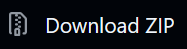

# Lifegen Genetics

**Lifegen** and **Genemod** (the genetics mod) put together into one game. You play as your own cat like in Lifegen, and every cat has real genes like in Genemod, so kits actually look like their parents.

**Join the Discord server** for help, news and bug reports: [discord.gg/Kxdvk5eXC9](https://discord.gg/Kxdvk5eXC9)

I ask that if you make a fork or a version of this mod built off of my code, you credit me as well as the creators of Lifegen, Clangen, and Genemod too.

## How to play

Versions downloaded before October 27, 2026 don't have run.command, so Mac players should download the latest version.

Lifegen Genetics runs from its source code, so there's no app to install. Instead you install **uv**. After that, starting the game is a double-click (or one command on Linux).

You need an internet connection the first time you start the game: uv downloads the right version of Python and everything the game needs.

> **Important:** your Clans are saved in the **saves** folder inside the game folder. **Every time you download a new version, copy your saves folder into the new game folder**, or your Clans won't be there. See [Updating](#updating-to-a-new-version). The game tells you on the start screen when a new version is out.

Jump to: [Windows](#windows) | [Mac](#mac) | [Linux](#linux) | [Updating](#updating-to-a-new-version) | [Problems](#if-something-goes-wrong)

---

### Windows

**1. Install uv (one time only)**

1. Press the **Windows key**, type **PowerShell** and open it.
2. Copy this line, paste it into the PowerShell window (right-click pastes) and press **Enter**:
   ```
   powershell -ExecutionPolicy ByPass -c "irm https://astral.sh/uv/install.ps1 | iex"
   ```
3. When it says it's done, close PowerShell.

**2. Download the game**

1. Go to the [Lifegen Genetics GitHub page](https://github.com/Tropicaluwu/Lifegen-Genetics-dev) (the page you're reading this on).
2. Near the top, click the green **Code** button:

   
3. Click **Download ZIP**:

   
4. Find the zip in your Downloads, right-click it and choose **Extract All**. Put the folder somewhere easy to find, like your Desktop.

**3. Play**

1. Open the folder you extracted and double-click **run.bat**.
2. If Windows says **"Windows protected your PC"**, click **More info**, then **Run anyway**. It only asks the first time.
3. A black window opens and sets things up (the first time takes a minute or two), then the game opens. Keep the black window open while you play.

Next time, just double-click **run.bat** again.

---

### Mac

**1. Install uv (one time only)**

1. Open **Terminal** (press **Cmd + Space**, type **Terminal** and press **Enter**).
2. Copy this line, paste it into Terminal (**Cmd + V**) and press **Enter**:
   ```
   curl -LsSf https://astral.sh/uv/install.sh | sh
   ```
3. When it says it's done, close Terminal.

**2. Download the game**

1. Go to the [Lifegen Genetics GitHub page](https://github.com/Tropicaluwu/Lifegen-Genetics-dev) (the page you're reading this on).
2. Near the top, click the green **Code** button:

   
3. Click **Download ZIP**:

   
4. Open the zip from your Downloads (double-click it) to unzip it. Move the folder somewhere easy to find, like your Desktop.

**3. Play**

1. Open the folder and **right-click** (or Control-click) **run.command**, then choose **Open**.
2. Your Mac will warn you that it's from an unidentified developer. Click **Open**.
   - On newer Macs there may be no Open button, only **Done**. Then open **System Settings --> Privacy & Security**, scroll down to the message about **run.command** and click **Open Anyway**, then right-click **run.command** and choose **Open** again.
3. A Terminal window opens and sets things up (the first time takes a minute or two), then the game opens. Keep the Terminal window open while you play.

Next time, just double-click **run.command**.

---

### Linux

**1. Install uv (one time only)**

Open a terminal, paste this and press **Enter**:
```
curl -LsSf https://astral.sh/uv/install.sh | sh
```
(No curl? Use `wget -qO- https://astral.sh/uv/install.sh | sh` instead.) Then close the terminal and open a new one.

**2. Download the game**

On the [Lifegen Genetics GitHub page](https://github.com/Tropicaluwu/Lifegen-Genetics-dev), click the green **Code** button, then **Download ZIP**, and unzip it.

**3. Play**

In the terminal, go into the unzipped folder and start the game:
```
cd path/to/the/folder
bash run.sh
```
(Tip: type `cd ` with a space, then drag the folder into the terminal window to fill in its path.)

Some file managers can also start it: right-click **run.sh** and choose **Run as a Program** (or **Run**).

---

### Updating to a new version

When a new version is out, the game shows **Update Available!** on the start screen. Click it to see how to update.

Your saves are inside the game folder, in a folder called **saves**. So **every time** you update, bring them along:

1. Download the new version the same way as the first time (green **Code** button, then **Download ZIP**) and unzip it.
2. Copy the **saves** folder from your old game folder into the new one. If the new folder already has a **saves** folder, replace it.
3. Start the game from the new folder the same way as before.

Once your Clans show up in the new version, you can delete the old folder.

---

### If something goes wrong

- **"uv is not recognized" / "uv: command not found":** close the window and try again. If it still happens, restart your computer. If it still happens even after that, uv didn't install: repeat step 1.
- **The window closes right away (Windows):** right-click inside the game folder, choose **Open in Terminal**, type `.\run.bat` and press **Enter**. The window stays open, so you can see the error.
- **Mac: "run.command can't be opened":** see step 3 for Mac (**Open Anyway** in Privacy & Security).
- **Mac: "run.command could not be executed because you do not have appropriate access privileges":** download the latest version (fixed in v1.2.6). Or open Terminal, type `chmod +x ` (with a space after it), drag **run.command** into the window and press Return.
- **It got stuck or failed the first time:** check your internet connection and start it again. It picks up where it left off.
- **Windows asks to replace or skip files when unzipping:** pick either one. Those files are exact copies.
- **"Microsoft Visual C++ 14.0 or greater is required" or "Failed to build cffi" (Windows):** Windows can't find a ready-made part of the game for your setup. This can happen on newer laptops with ARM processors, or when the setup picked the wrong version of Python. To fix it:
  1. In the game folder, delete the **.venv** folder if there is one. It's hidden: in File Explorer, click **View**, then **Show**, then **Hidden items**.
  2. Right-click an empty spot in the game folder and choose **Open in Terminal**. Paste this and press **Enter**:
     ```
     uv sync --python cpython-3.12-windows-x86_64-none
     ```
  3. When it's done, close the window and double-click **run.bat** as usual.
- **"failed to hardlink file" or "incompatible hardlinks" (Windows):** the game folder is (or was) inside OneDrive. Move the game folder somewhere outside OneDrive, like **C:\Games**. Then delete the hidden **.venv** folder inside the game folder, open **PowerShell**, run `uv cache clean`, and start the game again. OneDrive can also get in the way of your saves, so the game is best kept outside it.
- **"An Application Control policy has blocked this file" or "python.exe - Bad Image" (Windows 11):** this is Windows Smart App Control, not a broken download. See [Blocked by Smart App Control](#blocked-by-smart-app-control).
- **My Clans are gone after updating:** copy the **saves** folder from the old game folder into the new one (see [Updating](#updating-to-a-new-version)).


### Blocked by Smart App Control

Smart App Control is a Windows 11 security feature that blocks programs it doesn't recognize, and that includes the copy of Python that uv downloads. You might see **"An Application Control policy has blocked this file (os error 4551)"**, or a **"python.exe - Bad Image"** window with **error status 0xc0e90002** that says `python312.dll` is damaged. It isn't damaged, it's being blocked.

**Easiest fix:** open **Windows Security** > **App & browser control** > **Smart App Control** and turn it off, then start the game again. Windows may not let you turn it back on without resetting your PC, so decide if that's okay first.

**If you'd rather keep it on,** you can try playing with the official Python instead of uv. This might not work on every PC, because Windows can still block the game's add-on files.

1. Install **Python 3.12** from [python.org](https://www.python.org/downloads/). Pick a 3.12 version that has a Windows installer, and leave the "py launcher" option ticked.
2. In the game folder, right-click an empty spot and choose **Open in Terminal**. If that isn't there, click the address bar at the top of the folder, type `cmd` and press **Enter**.
3. Run this to remove uv's Python, so it can't get picked by mistake:
   ```
   uv python uninstall 3.12
   ```
4. Run this once to install what the game needs:
   ```
   py -V:PythonCore/3.12 -m pip install "black~=23.0" "cryptography~=42.0" "pgpy~=0.6" "platformdirs~=3.3" "pydantic>=2.12.0" "pygame-ce~=2.2" "pygame-gui>=0.6.14" "requests~=2.28" "strenum~=0.4" "tomli>=2.2.1" "ujson~=5.7"
   ```
5. Start the game with this line, every time you play:
   ```
   py -V:PythonCore/3.12 main.py
   ```

Don't use `run.bat` for this, because it downloads uv's Python again. To start the game with a double-click, make a text file in the game folder called `play.bat` with these lines in it:
```
@echo off
py -V:PythonCore/3.12 main.py
pause
```

If it's still blocked and the error mentions `Python312\Lib\site-packages`, Windows is blocking the add-on files too. Your options then are turning Smart App Control off, playing on another PC, or using a virtual machine.

---

## What's new in v1.2: the big update

Lifegen Genetics now runs on the newest development versions of Clangen, Lifegen and Genemod (updated November 7, 2026), so you get everything they've added since v1.1.

> **Before you update, keep a copy of your saves folder.** Your Clans load in v1.2, but once you've played them here they might not open in v1.1 anymore.

- **Clangen's newest version:** its new event and patrol systems, the new screens for making a Clan, the chinchilla color, and new background sounds for each biome
- **The newest Genemod and Lifegen**, with all their changes and fixes
- **"Healer" everywhere** instead of "medicine cat"
- **Easier cat maker lists:** white patches are grouped by where they are on the cat, and eye colors by color family
- **Made up family looks like family:** your cat's made up parents and siblings share their pattern and white markings
- Plus a lot of fixes (see [changelog.txt](changelog.txt))

The cat maker, the Names button and everything else from v1.1 are still here.

## Credits

**None of this would exist without these teams. All of the real work is theirs:**

### Lifegen
Made by the **Lifegen team**. Lifegen is the mod where you play as your own cat.
- GitHub: [sedgestripe/clangen](https://github.com/sedgestripe/clangen)
- Website: [mods.clangen.io/LifeGen](https://mods.clangen.io/LifeGen/download)
- Discord: [discord.gg/lifegen](https://discord.gg/lifegen)
- Full list of everyone who worked on it: [Lifegen credits](https://docs.google.com/document/d/1XCm5Eo-y5VA6W9quDMbF3VNyKL7S8_9Tl4c2buuiA8g/edit?usp=sharing)

### Genemod (Genetics mod)
Made by **Chinch-Bug** and contributors. Genemod gives every cat real, inheritable genes.
- GitHub: [Chinch-Bug/clangen-genemod](https://github.com/Chinch-Bug/clangen-genemod)

### Clangen
The game both mods are built on. Original creator **just-some-cat**, fan edit by **SableSteel** and the Clangen team.
- GitHub: [ClanGenOfficial/clangen](https://github.com/ClanGenOfficial/clangen)
- Itch.io: [sablesteel.itch.io/clan-gen-fan-edit](https://sablesteel.itch.io/clan-gen-fan-edit)

This is an unofficial combination made for fun. **Please don't take bug reports from it or ask for help to the Lifegen, Genemod or Clangen teams**, they didn't make this mod and can **NOT** help with it.

## What's in it

- Everything from Lifegen: playing as your own cat, talking, patrols, the Dark Forest, shunning, affairs and the rest
- Genemod's genetics: coat color, patterns, white spotting, eyes, fur types, ear and tail traits, genetic conditions and offspring prediction
- Genemod's multi clan mode (optional, picked when you make a new clan)
- Built on the development versions of Clangen, Lifegen and Genemod (updated November 7, 2026)
- Fixes for crashes that came from putting the two mods together

See [changelog.txt](changelog.txt) for the full list.

## Using a Lifegen save

Lifegen saves work. Copy your clan's folder and its `<Name>clan.json` file (for example a `Leap` folder and `Leapclan.json`) into the **saves** folder inside the Lifegen Genetics game folder (start the game once first so the folder exists).

On Windows, Lifegen keeps its saves in `%LOCALAPPDATA%\LifeGen\LifeGen\saves` (paste that into the File Explorer address bar to open it).

The first time the save loads, every cat gets genes made from its old pelt. Keep a backup of the original, because once it's saved here it won't load in regular Lifegen anymore.

## License

Code is under the Mozilla Public License 2.0 and the sprites/art are under CC BY-NC 4.0, same as Clangen, Lifegen and Genemod. See [LICENSE.md](LICENSE.md).
