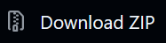

# LifeGen Genetics

**LifeGen** and **Genemod** (the genetics mod) put together into one game. You play as your own cat like in LifeGen, and every cat has real genes like in Genemod, so kits actually look like their parents.
I ask that if you make a fork or a version of this mod built off of my code, you credit me as well as the creators of LifeGen, ClanGen, and Genemod too.
## How to play

Updated October 27, 2026. Versions downloaded before this date don't have run.command, so Mac players should download the latest version.

LifeGen Genetics runs from its source code, so there's no app to install. Instead you install **uv**. After that, starting the game is a double-click (or one command on Linux).

You need an internet connection the first time you start the game: uv downloads the right version of Python and everything the game needs.

> **Important:** your Clans are saved in the **saves** folder inside the game folder. **Every time you download a new version, copy your saves folder into the new game folder**, or your Clans won't be there. See [Updating](#updating-to-a-new-version). The game tells you on the start screen when a new version is out.

Jump to: [Windows](#windows) | [Mac](#mac) | [Linux](#linux) | [Updating](#updating-to-a-new-version) | [Problems](#if-something-goes-wrong)

---

### Windows

**1. Install uv (one time only)**

1. Press the **Windows key**, type **PowerShell** and open it.
2. Copy this line, paste it into the PowerShell window (right-click pastes) and press **Enter**:
   ```
   powershell -ExecutionPolicy ByPass -c "irm https://astral.sh/uv/install.ps1 | iex"
   ```
3. When it says it's done, close PowerShell.

**2. Download the game**

1. Go to the [LifeGen Genetics GitHub page](https://github.com/Tropicaluwu/Lifegen-Genetics-dev) (the page you're reading this on).
2. Near the top, click the green **Code** button:

   
3. Click **Download ZIP**:

   
4. Find the zip in your Downloads, right-click it and choose **Extract All**. Put the folder somewhere easy to find, like your Desktop.

**3. Play**

1. Open the folder you extracted and double-click **run.bat**.
2. If Windows says **"Windows protected your PC"**, click **More info**, then **Run anyway**. It only asks the first time.
3. A black window opens and sets things up (the first time takes a minute or two), then the game opens. Keep the black window open while you play.

Next time, just double-click **run.bat** again.

---

### Mac

**1. Install uv (one time only)**

1. Open **Terminal** (press **Cmd + Space**, type **Terminal** and press **Enter**).
2. Copy this line, paste it into Terminal (**Cmd + V**) and press **Enter**:
   ```
   curl -LsSf https://astral.sh/uv/install.sh | sh
   ```
3. When it says it's done, close Terminal.

**2. Download the game**

1. Go to the [LifeGen Genetics GitHub page](https://github.com/Tropicaluwu/Lifegen-Genetics-dev) (the page you're reading this on).
2. Near the top, click the green **Code** button:

   
3. Click **Download ZIP**:

   
4. Open the zip from your Downloads (double-click it) to unzip it. Move the folder somewhere easy to find, like your Desktop.

**3. Play**

1. Open the folder and **right-click** (or Control-click) **run.command**, then choose **Open**.
2. Your Mac will warn you that it's from an unidentified developer. Click **Open**.
   - On newer Macs there may be no Open button, only **Done**. Then open **System Settings --> Privacy & Security**, scroll down to the message about **run.command** and click **Open Anyway**, then right-click **run.command** and choose **Open** again.
3. A Terminal window opens and sets things up (the first time takes a minute or two), then the game opens. Keep the Terminal window open while you play.

Next time, just double-click **run.command**.

---

### Linux

**1. Install uv (one time only)**

Open a terminal, paste this and press **Enter**:
```
curl -LsSf https://astral.sh/uv/install.sh | sh
```
(No curl? Use `wget -qO- https://astral.sh/uv/install.sh | sh` instead.) Then close the terminal and open a new one.

**2. Download the game**

On the [LifeGen Genetics GitHub page](https://github.com/Tropicaluwu/Lifegen-Genetics-dev), click the green **Code** button, then **Download ZIP**, and unzip it.

**3. Play**

In the terminal, go into the unzipped folder and start the game:
```
cd path/to/the/folder
bash run.sh
```
(Tip: type `cd ` with a space, then drag the folder into the terminal window to fill in its path.)

Some file managers can also start it: right-click **run.sh** and choose **Run as a Program** (or **Run**).

---

### Updating to a new version

When a new version is out, the game shows **Update Available!** on the start screen. Click it to see how to update.

Your saves are inside the game folder, in a folder called **saves**. So **every time** you update, bring them along:

1. Download the new version the same way as the first time (green **Code** button, then **Download ZIP**) and unzip it.
2. Copy the **saves** folder from your old game folder into the new one. If the new folder already has a **saves** folder, replace it.
3. Start the game from the new folder the same way as before.

Once your Clans show up in the new version, you can delete the old folder.

---

### If something goes wrong

- **"uv is not recognized" / "uv: command not found":** close the window and try again. If it still happens, restart your computer. If it still happens even after that, uv didn't install: repeat step 1.
- **The window closes right away (Windows):** right-click inside the game folder, choose **Open in Terminal**, type `.\run.bat` and press **Enter**. The window stays open, so you can see the error.
- **Mac: "run.command can't be opened":** see step 3 for Mac (**Open Anyway** in Privacy & Security).
- **It got stuck or failed the first time:** check your internet connection and start it again. It picks up where it left off.
- **My Clans are gone after updating:** copy the **saves** folder from the old game folder into the new one (see [Updating](#updating-to-a-new-version)).

---

## What's new: the cat maker update!

Since the Reddit post did so well, I'm releasing my cat maker update early! There's bound to be bugs, but it has been tested a lot :3 Enjoy!

- **A fully genetic cat maker** for your main character: Genemod's real colors, patterns, points, eyes, fur and body genes, every white patch (pick as many as you like), and torties with their own patch colors and patterns. Click a cat first and press Customize to start from that cat
- **A Names button** on the main menu and in the Clan settings: add and take out prefixes, suffixes, rank endings, loner, kittypet and Clan names, for all saves or just one
- **Genemod and ClanGen saves** can be loaded too
- Plus a bunch of fixes (see [changelog.txt](changelog.txt))
- **v1.1.1:** cat maker fixes (Fur Length buttons, "clear all" white, Random cat odds and a rare crash)
- **v1.1.2:** a how-to-play guide for Windows, Mac and Linux, double-click to play on Mac, the game now tells you when there's a new version, and a few more cat maker fixes

## Credits

**None of this would exist without these teams. All of the real work is theirs:**

### LifeGen
Made by the **LifeGen team**. LifeGen is the mod where you play as your own cat.
- GitHub: [sedgestripe/clangen](https://github.com/sedgestripe/clangen)
- Website: [mods.clangen.io/LifeGen](https://mods.clangen.io/LifeGen/download)
- Discord: [discord.gg/lifegen](https://discord.gg/lifegen)
- Full list of everyone who worked on it: [LifeGen credits](https://docs.google.com/document/d/1XCm5Eo-y5VA6W9quDMbF3VNyKL7S8_9Tl4c2buuiA8g/edit?usp=sharing)

### Genemod (Genetics mod)
Made by **Chinch-Bug** and contributors. Genemod gives every cat real, inheritable genes.
- GitHub: [Chinch-Bug/clangen-genemod](https://github.com/Chinch-Bug/clangen-genemod)

### ClanGen
The game both mods are built on. Original creator **just-some-cat**, fan edit by **SableSteel** and the ClanGen team.
- GitHub: [ClanGenOfficial/clangen](https://github.com/ClanGenOfficial/clangen)
- Itch.io: [sablesteel.itch.io/clan-gen-fan-edit](https://sablesteel.itch.io/clan-gen-fan-edit)

This is an unofficial combination made for fun. **Please don't take bug reports from it or ask for help to the LifeGen, Genemod or ClanGen teams**, they didn't make this mod and can **NOT** help with it.

## What's in it

- Everything from LifeGen: playing as your own cat, talking, patrols, the Dark Forest, shunning, affairs and the rest
- Genemod's genetics: coat color, patterns, white spotting, eyes, fur types, ear and tail traits, genetic conditions and offspring prediction
- Genemod's multi clan mode (optional, picked when you make a new clan)
- Up to date with ClanGen v0.13.4
- Fixes for crashes that came from putting the two mods together

See [changelog.txt](changelog.txt) for the full list.

## Using a LifeGen save

LifeGen saves work. Copy your clan's folder and its `<Name>clan.json` file (for example a `Leap` folder and `Leapclan.json`) into the **saves** folder inside the LifeGen Genetics game folder (start the game once first so the folder exists).

On Windows, LifeGen keeps its saves in `%LOCALAPPDATA%\LifeGen\LifeGen\saves` (paste that into the File Explorer address bar to open it).

The first time the save loads, every cat gets genes made from its old pelt. Keep a backup of the original, because once it's saved here it won't load in regular LifeGen anymore.

## License

Code is under the Mozilla Public License 2.0 and the sprites/art are under CC BY-NC 4.0, same as ClanGen, LifeGen and Genemod. See [LICENSE.md](LICENSE.md).
